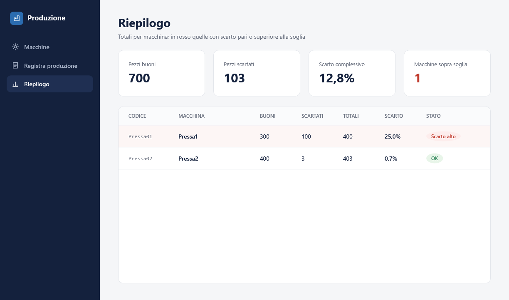
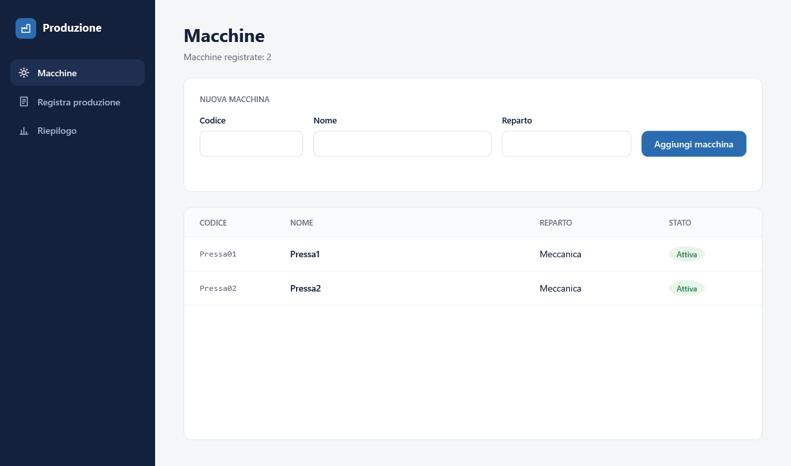
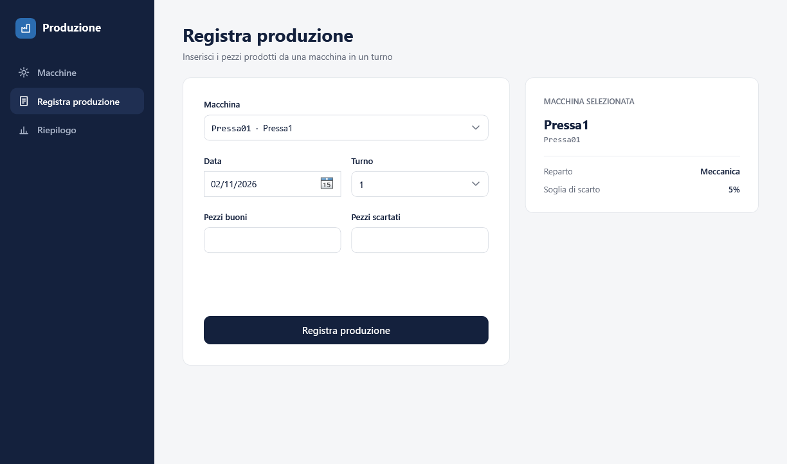

# Registro Produzione

Applicazione desktop in **C# / .NET 10** per registrare la produzione delle macchine di un reparto:
per ogni macchina, giorno e turno si inseriscono i pezzi buoni e i pezzi scartati, e l'applicazione
calcola la percentuale di scarto, segnalando le macchine che superano la soglia.

La stessa logica (progetto **Core**) è usata da due interfacce diverse: un'applicazione **console**
e un'applicazione **WPF** con pattern MVVM.



| Macchine | Registra produzione |
|---|---|
|  |  |

## Funzionalità

- **Anagrafica macchine**: codice, nome, reparto, stato attiva/inattiva.
- **Registrazione della produzione** per macchina, data e turno (1, 2, 3), con controlli:
  turno valido, pezzi non negativi, data non futura, macchina esistente e attiva,
  un solo inserimento per macchina/data/turno.
- **Avviso di scarto alto**: se una registrazione supera la soglia (5%) il servizio lancia un evento,
  che la console e la WPF mostrano a modo loro.
- **Riepilogo** per macchina con totali e percentuale di scarto; anche le macchine senza produzione
  compaiono, con valori a zero.

## Architettura

```
RegistroProduzione.slnx
├── database/Schema.sql          tabelle, vincoli, chiavi
├── RegistroProduzione.Core      logica, nessuna dipendenza dall'interfaccia
│   ├── Models/                  Macchina, Produzione, RiepilogoMacchina (record)
│   ├── Repositories/            IMacchineRepository, IProduzioniRepository
│   │                            + implementazioni SQL con ADO.NET
│   ├── Services/                ServizioProduzione: regole di business ed evento ScartoAlto
│   ├── Events/                  ScartoAltoEventArgs
│   └── Avvio/                   FabbricaServizio: compone repository e servizio
├── RegistroProduzione.App       interfaccia console
└── RegistroProduzione.Wpf       interfaccia WPF (MVVM)
    ├── Commands/                RelayCommand
    ├── ViewModels/              un ViewModel per schermata + MainViewModel per la navigazione
    └── Views/                   UserControl associati ai ViewModel tramite DataTemplate
```

Il flusso è sempre lo stesso, dal basso verso l'alto:

```
SQL Server  ←  Repository (ADO.NET)  ←  ServizioProduzione  ←  Console / WPF
```

## Scelte tecniche

- **ADO.NET puro** (`Microsoft.Data.SqlClient`), senza ORM: query scritte a mano e parametrizzate
  (`@parametro`), `using` su connessioni, comandi e lettori.
- **Integrità dei dati nel database**: `FOREIGN KEY`, `CHECK` su turno e pezzi, `UNIQUE` su
  macchina + data + turno. Il servizio ripete i controlli per dare messaggi chiari; il database
  resta l'ultima garanzia.
- **`OUTPUT INSERTED.*`** per ottenere la riga appena inserita (con il suo `Id`) in una sola query.
- **`LEFT JOIN` + `ISNULL(SUM(...), 0)`** nel riepilogo, per includere le macchine senza produzione.
- **Interfacce dei repository** iniettate nel costruttore del servizio (inversione delle dipendenze):
  il servizio non sa che sotto c'è SQL Server.
- **Composizione in un solo punto** (`FabbricaServizio`), usata da entrambe le applicazioni;
  la stringa di connessione arriva da `appsettings.json`.
- **Evento `ScartoAlto`** (`EventHandler<T>`): il servizio segnala, l'interfaccia decide come mostrarlo.
  In WPF il ViewModel si disiscrive in `Dispose`, chiamato da `MainViewModel` quando si cambia schermata,
  per evitare memory leak.
- **MVVM senza librerie esterne**: `ViewModelBase` con `INotifyPropertyChanged`, `RelayCommand`,
  `ObservableCollection`, navigazione con `ContentControl` + `DataTemplate`, stili centralizzati
  in `App.xaml`.

## Come avviarlo

Requisiti: Windows, Visual Studio 2026 (o .NET 10 SDK), SQL Server LocalDB.

1. Crea il database ed esegui lo schema:
   ```
   sqlcmd -S "(localdb)\MSSQLLocalDB" -Q "CREATE DATABASE RegistroProduzione"
   sqlcmd -S "(localdb)\MSSQLLocalDB" -d RegistroProduzione -i database\Schema.sql
   ```
2. Se usi un'istanza diversa, modifica la stringa `RegistroProduzione` in `appsettings.json`
   (in `RegistroProduzione.App` e `RegistroProduzione.Wpf`).
3. Apri `RegistroProduzione.slnx`, imposta come progetto di avvio `RegistroProduzione.Wpf`
   (o `RegistroProduzione.App` per la console) e avvia con F5.

## Possibili sviluppi

- Test automatici (xUnit) sul servizio, con repository finti.
- Metodi asincroni (`async`/`await`) per l'accesso ai dati.
- Contenitore di dependency injection (`Microsoft.Extensions.DependencyInjection`).
- Modifica e disattivazione delle macchine dall'interfaccia, filtri per periodo nel riepilogo.
